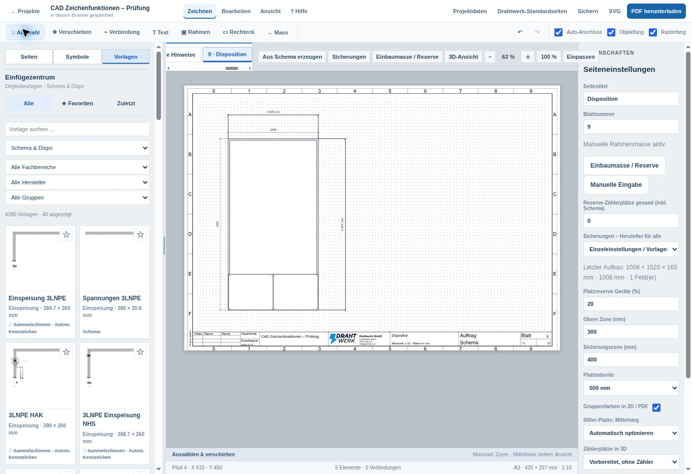
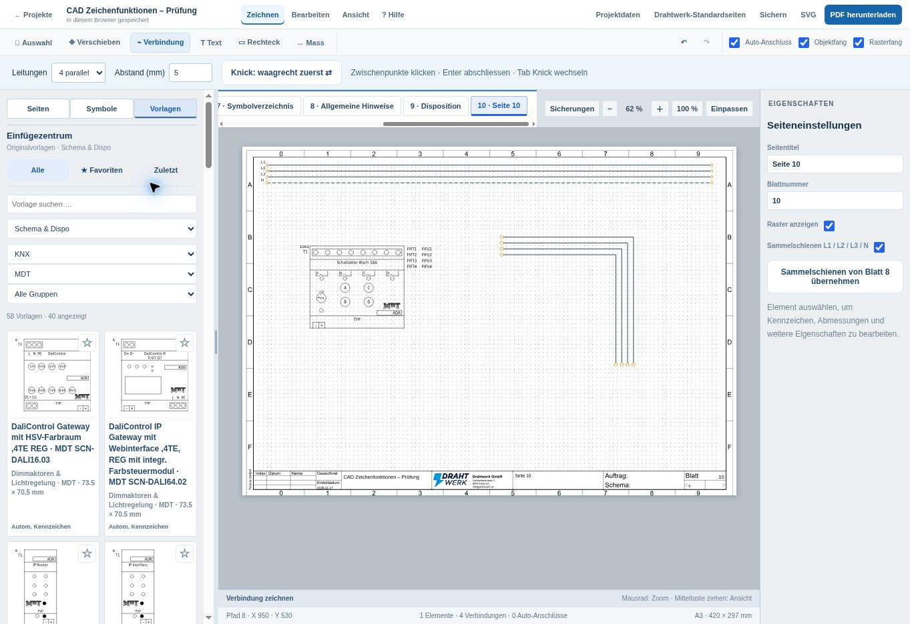

# Zeichenwerkzeuge und Bibliothek · 17.11.2026

Referenz: die vom Benutzer bereitgestellten Videos «Tinline dispo zeichnen» und «Tinline schema zeichnen» sowie der [Vorlagenordner](https://drive.google.com/drive/folders/1ls1Twn4uEc6FOfqtiK134KaLzgrIFkAm).

## Abgleich mit den Videos

| Beobachteter Ablauf | Umsetzung in diesem Stand |
| --- | --- |
| Dispo: Rahmen mit realen Massen anlegen | Rahmenwerkzeug mit Breite/Höhe, Mausvorschau und Seitenmassstab |
| Dispo: Geräte nebeneinander einrasten | Kanten- und Mittellinienfang beim Platzieren und Verschieben |
| Dispo: Breiten, Höhen und Teilstrecken messen | Drei-Punkt-Bemassung horizontal/vertikal mit Objektfang |
| Schema: mehrere parallele Leiter mit Knicken | 1–5 Leiter, Abstand, Knickrichtung, Vorschau, gemeinsames Undo |
| Schema: Geräte und Makros platzieren | Bestehende Mausvorschau erweitert um zusätzliche Bibliotheken und explizite Symbolskalierung |
| Neue Funktionen und KNX finden | Fachbereich, Hersteller, Funktionsgruppen, XML-Beschreibungen und Artikeltyp |

## Grenzen und nächste Ausbauschritte

- Masse sind eigenständige Zeichnungsobjekte. Nach einer Änderung der gemessenen Geräte werden sie neu gesetzt.
- Leiter sind grafisch und über explizite Endpunktreferenzen verbunden. Das Einsetzen eines Geräts in eine bestehende Leitung trennt diese noch nicht automatisch auf. Es gibt kein Routing um Hindernisse.
- PDF → Dispo ist ein eigener Folgeschritt: Seiten/Geräte erkennen, unsichere Erkennungen zur Korrektur anzeigen, physische Artikel/Masse zuordnen, dann den vorhandenen Dispo-Generator verwenden. Keine automatische Übernahme unbestätigter Gerätemasse.
- Lite/Pro ist noch nicht festgelegt. Sinnvolle spätere Aufteilung: manuelles Zeichnen, Bibliotheken, Speichern und Export als gemeinsame Grundlage; automatisierte Ableitung und Datenanbindung als zusätzliche Funktionen. Keine Lizenzsperren oder Preise implementiert.

## Importumfang

4’285 verfügbare Vorlagen = 1’136 bestehende + 3’149 zusätzliche. Die bestehenden IDs und Grafiken bleiben erhalten. Die gesamte Bibliothek wird automatisiert auf das eingeschränkte sichere Vektorformat geprüft; dies ersetzt keinen visuellen Einzelvergleich jeder Originaldatei.

| Zusätzliche Vorlagen nach Fachbereich | Anzahl |
| --- | ---: |
| Elektroinstallation | 1425 |
| Elektroschema | 171 |
| Gebäudeautomation | 190 |
| Heizung, Lüftung, Klima | 118 |
| KNX | 464 |
| Netzwerk & EDV | 50 |
| Prinzipschema | 34 |
| SPS & Steuerung | 363 |
| Schema einpolig | 334 |

## Nicht konvertierte Originaldateien

Diese 33 Dateien erscheinen nicht als scheinbar vollständige Vorlagen im Editor. REGION/ACIS-Flächen sind im Konvertierungsergebnis nicht vollständig darstellbar. Für eine vollständige Übernahme ist eine lesbare 2D-Geometrie (z. B. exportierte DXF) dieser Einträge erforderlich; fehlende Umrisse wurden nicht geraten. Die vollständigen Quellpfade und Fehlermeldungen stehen auch in `cad/templates/catalog.json → excluded`.

| Datei | Grund |
| --- | --- |
| PIR360-1.dwg | empty bounding box |
| Steckdose-USB-2x.dwg | empty bounding box |
| 08Fundament Text.dwg | 'NoneType' object has no attribute 'filename' |
| ISO7010-E-Fluchtwegzeichen.dwg | empty bounding box |
| A0000-02_HTG911H.dwg | DWG konnte nicht nach DXF konvertiert werden |
| A0000-01_SM102E.dwg | REGION-Geometrie nicht vollständig darstellbar |
| A0000-02_SM200.dwg | REGION-Geometrie nicht vollständig darstellbar |
| A0000-03_SM210.dwg | REGION-Geometrie nicht vollständig darstellbar |
| A0000-01_SM103E.dwg | REGION-Geometrie nicht vollständig darstellbar |
| A0000-02_SM201.dwg | REGION-Geometrie nicht vollständig darstellbar |
| A0000-03_SM202.dwg | REGION-Geometrie nicht vollständig darstellbar |
| A0000-04_SM203.dwg | REGION-Geometrie nicht vollständig darstellbar |
| A0000-05_SM204.dwg | REGION-Geometrie nicht vollständig darstellbar |
| A0000-06_SM205.dwg | REGION-Geometrie nicht vollständig darstellbar |
| A0000-07_SM211.dwg | REGION-Geometrie nicht vollständig darstellbar |
| A0000-08_SM214.dwg | REGION-Geometrie nicht vollständig darstellbar |
| A0000-00_RED012X.dwg | REGION-Geometrie nicht vollständig darstellbar |
| A1199_RED011X.dwg | REGION-Geometrie nicht vollständig darstellbar |
| A0000-03_RED115X.dwg | REGION-Geometrie nicht vollständig darstellbar |
| A1199_RED111X.dwg | REGION-Geometrie nicht vollständig darstellbar |
| A0000-11_RED711X.dwg | REGION-Geometrie nicht vollständig darstellbar |
| A0000-12_RED712X.dwg | REGION-Geometrie nicht vollständig darstellbar |
| A0000-01_ST320.dwg | REGION-Geometrie nicht vollständig darstellbar |
| A0000_HTG911H.dwg | REGION-Geometrie nicht vollständig darstellbar |
| A0000_TGA200.dwg | REGION-Geometrie nicht vollständig darstellbar |
| A0000_TXA112.dwg | REGION-Geometrie nicht vollständig darstellbar |
| A0000_TXA114.dwg | REGION-Geometrie nicht vollständig darstellbar |
| A0000_TYF130.dwg | REGION-Geometrie nicht vollständig darstellbar |
| A0000_TYFS120.dwg | REGION-Geometrie nicht vollständig darstellbar |
| A0000_TYFS121.dwg | REGION-Geometrie nicht vollständig darstellbar |
| A1199_TYFS110.dwg | REGION-Geometrie nicht vollständig darstellbar |
| A0000_TXF121.dwg | REGION-Geometrie nicht vollständig darstellbar |
| KS_1_3U_.dwg | DWG konnte nicht nach DXF konvertiert werden |

## Prüfung dieses Stands

- 343 CAD-Tests erfolgreich (`node --test tests/cad*.test.mjs`).
- Alle 4’285 Vorlagen validiert; alle 3’931 Datensätze mit bearbeitbaren Texten/Leitungsenden validiert. Die 942 bisherigen Textdatensätze bleiben unverändert, 2’989 kamen hinzu und werden direkt mit der jeweiligen Vorlage geladen, ohne die zentrale Startdatei zu vergrössern.
- Browser: Rahmen 1008 × 1920 mm, horizontale und vertikale Bemassung, aneinander einrastende 500-mm-Platten, MDT-KNX-Aktor, vier parallele Leiter mit Knick, Undo/Redo und gespeichertes Projekt nach Neuladen geprüft.
- PDF-Download mit sieben A3-Querseiten; Bemassung 1008/1920 mm im Export visuell kontrolliert.

